<div align="center">

[](https://github.com/TheMamunZx/software-reverse-engineering-studio)
[](https://claude.ai/code)
[](https://opencode.dev)

**Analyze authorized software behavior · Document observable patterns · Build independent implementations**

[Overview](#about-software-reverse-engineering-studio) · [Quick Start](#quick-start) · [Architecture](#master-skill-architecture) · [Workflow](#reverse-engineering-workflow) · [Installation](#claude-code-installation) · [Security](#security-and-authorization-requirements)

</div>

---

## About Software Reverse Engineering Studio

Coordinate end-to-end software reverse engineering workflows through one discoverable master skill. Analyze software you own or are authorized to inspect, document observable behavior, and create lawful independent implementations without copying protected source code or bypassing access controls.

This repository provides agent-driven reverse engineering capabilities for websites, web applications, Android APKs, binaries, and API traffic. Internal specialist modules are loaded automatically based on analysis targets—you select only the master skill.

## Project Overview and Statistics

| Metric | Value |
|--------|-------|
| **Master Skills** | 1 |
| **Internal Modules** | 8 |
| **Human-Centered Design Modules** | 3 |
| **Supported Platforms** | Claude Code, OpenCode |
| **Analysis Types** | Web, APK, Binary, API, Software |

## What Can You Analyze?

### Observable Targets

- **Websites and Web Applications** — DOM structure, responsive layouts, component behavior, navigation flows, public assets
- **Android APKs** — manifest inspection, resource extraction, static structure analysis, declared permissions
- **Binary Files** — format inspection, static analysis, symbol extraction, basic disassembly
- **API Traffic** — authorized endpoint behavior, request/response patterns, data contracts, error handling
- **Software Architecture** — technology stack identification, component mapping, interaction patterns

### Limitations

- Cannot recover private source code from compiled artifacts or deployed websites
- Cannot bypass authentication, paywalls, DRM, or access controls
- Cannot extract proprietary algorithms or trade secrets
- Cannot analyze systems without proper authorization
- Cannot guarantee complete behavior coverage from external observation alone

## Master Skill Architecture

This repository exposes **one discoverable skill**:

```
software-reverse-engineering-studio
```

Invoke this master skill. It coordinates appropriate internal specialist modules automatically based on your analysis target and requirements.

### Internal Specialist Modules

| Module | Role | Loaded When |
|--------|------|-------------|
| `software-reverse-engineer` | General software analysis and implementation planning | Any reverse engineering task |
| `web-app-analyzer` | Website and web application structure analysis | Analyzing web-based targets |
| `apk-analysis-engineer` | Android APK inspection and component extraction | Analyzing APK files |
| `binary-analysis-engineer` | Binary file inspection and static analysis | Analyzing compiled binaries |
| `api-traffic-analyzer` | API endpoint behavior and contract documentation | Analyzing network traffic |
| `human-centered-product-design` | User-centered interface design principles | Building user-facing implementations |
| `design-quality-critic` | Design review and quality assessment | Reviewing implementation quality |
| `product-experience-engineer` | Professional product experience refinement | Polishing final deliverables |

**You do not select individual modules manually.** The master skill loads relevant references as needed.

## Reverse Engineering Workflow

```mermaid
graph LR
    A[Authorized Target] --> B[Reconnaissance]
    B --> C[Structure Analysis]
    C --> D[Behavior Mapping]
    D --> E[Component Extraction]
    E --> F[Architecture Planning]
    F --> G[Independent Implementation]
    G --> H[Visual Comparison]
    H --> I[Functional Testing]
    I --> J[Quality Review]
    J --> K[Final Deliverable]
```



### Workflow Phases

1. **Authorization Confirmation** — Verify ownership or permission to analyze target
2. **Reconnaissance** — Inventory accessible assets, screens, metadata, runtime conditions
3. **Structure Analysis** — Document DOM, components, navigation, file structure
4. **Behavior Mapping** — Observe interactions, state changes, data flows, API contracts
5. **Component Extraction** — Identify reusable patterns, layouts, styles, logic
6. **Architecture Planning** — Design independent implementation structure
7. **Independent Implementation** — Build original code using extracted knowledge
8. **Visual Comparison** — Validate layout, styling, responsive behavior against reference
9. **Functional Testing** — Verify feature parity within observed scope
10. **Quality Review** — Apply design critique and accessibility standards
11. **Final Deliverable** — Package code, documentation, evidence, and test results

## Website Analysis

### Capabilities

- Inspect publicly accessible pages and DOM structure
- Extract layout patterns, component hierarchy, responsive breakpoints
- Document navigation flows and user interaction patterns
- Identify CSS frameworks, JavaScript libraries, technology stack
- Analyze color schemes, typography, spacing systems
- Map routing structure and page relationships

### Deliverables

- Component and layout documentation
- CSS and design system extraction
- Navigation and routing maps
- Technology stack report
- Independent implementation codebase
- Visual parity validation report

## Web Application Analysis

### Capabilities

- Analyze authorized web application structure and behavior
- Document form interactions, validation patterns, error handling
- Map state management and data flow patterns
- Observe API endpoint usage and response contracts
- Identify authentication flows and protected routes
- Extract business logic patterns from observable behavior

### Deliverables

- Application architecture diagram
- API endpoint documentation
- State management specification
- Form and validation logic
- Error handling patterns
- Independent implementation with functional parity

## Android APK Analysis

### Capabilities

- Extract and inspect AndroidManifest.xml
- List declared permissions, activities, services, receivers
- Extract resources (layouts, strings, drawables)
- Analyze APK structure and component organization
- Document declared features and configurations
- Basic static analysis of DEX structure

### Limitations

- Cannot fully decompile obfuscated code to original source
- Cannot recover proprietary algorithms or business logic
- Cannot bypass code protection or DRM
- Cannot guarantee complete behavior reconstruction
- Extracted resources are for analysis, not unauthorized redistribution

### Deliverables

- Manifest analysis report
- Permission and feature documentation
- Resource inventory
- Component structure map
- UI layout documentation
- Independent implementation plan

## Binary and Software Analysis

### Capabilities

- Identify file format and executable type
- Extract symbols, imports, exports
- Basic disassembly and static inspection
- Dependency and library identification
- Entry point and section analysis

### Limitations

- Limited by obfuscation, packing, anti-analysis techniques
- Cannot recover original source code
- Cannot bypass software protection mechanisms
- Static analysis only—no dynamic execution tracing

### Deliverables

- Binary structure report
- Symbol and import tables
- Identified dependencies
- Architecture and calling convention documentation

## API and Network Traffic Analysis

### Capabilities

- Document authorized API endpoint behavior
- Extract request/response schemas
- Identify authentication and authorization patterns
- Map error codes and edge case handling
- Document rate limiting and pagination
- Observe data validation rules

### Requirements

- Must have authorization to access and analyze the API
- Cannot bypass authentication or access controls
- Cannot test beyond authorized scope
- Cannot extract private credentials or tokens

### Deliverables

- API endpoint documentation
- Request/response schema specifications
- Authentication flow documentation
- Error handling and validation rules
- Independent API client implementation

## Independent Implementation Workflow

### Design Principles

1. **Original Code** — Write new implementation, do not copy proprietary source
2. **Evidence-Based** — Base decisions on observable behavior, not assumptions
3. **Clean Architecture** — Use modern patterns and best practices
4. **Documented Assumptions** — Track confidence levels and unverified behavior
5. **Test Coverage** — Verify functional parity through automated tests
6. **Legal Compliance** — Respect intellectual property and access controls

### Implementation Process

- Translate behavioral observations into technical specifications
- Select appropriate technology stack and frameworks
- Design component architecture and data models
- Implement core functionality with clean, maintainable code
- Apply responsive design and accessibility standards
- Write tests covering observed behavior
- Document assumptions, limitations, and unverified features

## Human-Centered Product Design

Professional implementations apply **human-centered design principles** throughout development:

- **User-Centered Design** — Focus on user needs, goals, and context
- **Accessibility** — WCAG compliance, keyboard navigation, screen reader support
- **Visual Consistency** — Cohesive design system, typography, spacing
- **Professional Polish** — Attention to detail, smooth interactions, error states
- **Distinctive Character** — Avoid generic AI-generated layouts

### Design Quality Review

The `design-quality-critic` module reviews:

- Visual hierarchy and information architecture
- Color contrast and typography choices
- Layout consistency and responsive behavior
- Interaction patterns and micro-interactions
- Error messaging and edge case handling
- Accessibility and keyboard navigation

### Product Experience Engineering

The `product-experience-engineer` module refines:

- Loading states and perceived performance
- Transitions and animation timing
- Form design and validation feedback
- Empty states and onboarding flows
- Error recovery and help systems

## Quick Start

### Project-Local Installation

Copy the master skill into your target project:

```bash
cp -r .claude/skills/software-reverse-engineering-studio /path/to/target/project/.claude/skills/
```

### Invoke Master Skill

#### Claude Code

```bash
/software-reverse-engineering-studio
```

#### OpenCode

```bash
@software-reverse-engineering-studio
```

Agent discovery behavior varies by version and configuration. Verify the skill appears in available skills before use.

## Claude Code Installation

### Prerequisites

- Claude Code CLI or Desktop App
- Git (for cloning repository)
- Target project with `.claude/skills/` directory

### Installation Steps

1. Clone this repository:

```bash
git clone https://github.com/TheMamunZx/software-reverse-engineering-studio.git
```

2. Copy skill to target project:

```bash
cp -r software-reverse-engineering-studio/.claude/skills/software-reverse-engineering-studio \
  /path/to/your/project/.claude/skills/
```

3. Verify installation:

```bash
cd /path/to/your/project
# Skill should appear in available skills list
```

4. Invoke the skill:

```bash
/software-reverse-engineering-studio
```

## OpenCode Installation

### Prerequisites

- OpenCode CLI or compatible agent
- Git (for cloning repository)

### Installation Steps

1. Clone this repository:

```bash
git clone https://github.com/TheMamunZx/software-reverse-engineering-studio.git
```

2. Copy skill to target project:

```bash
cp -r software-reverse-engineering-studio/.claude/skills/software-reverse-engineering-studio \
  /path/to/your/project/.claude/skills/
```

3. Invoke the skill:

```bash
@software-reverse-engineering-studio
```

### Global Installation (Optional)

Some agent configurations support global skill directories. Consult your agent's documentation for global skill installation procedures.

## Supported Tools and Technologies

### Analysis Tools

- Browser DevTools (DOM inspection, network monitoring)
- `apktool` (APK decompilation and resource extraction)
- `jadx` (DEX to Java decompilation)
- Binary analysis tools (`file`, `strings`, `objdump`, `readelf`)
- Network proxies (authorized traffic inspection)

### Implementation Technologies

- **Web Frontend** — React, Vue, Svelte, vanilla JavaScript, HTML5, CSS3
- **Web Backend** — Node.js, Python, Go, Java, PHP
- **Mobile** — React Native, Flutter, native Android/Kotlin
- **APIs** — REST, GraphQL, WebSocket
- **Databases** — PostgreSQL, MongoDB, SQLite, Redis

Tool and framework selection adapts to target technology and project requirements.

## Security and Authorization Requirements

### Critical Requirements

⚠️ **Work only on systems and applications you own or are explicitly authorized to analyze.**

- **No Unauthorized Access** — Do not bypass authentication, paywalls, or access controls
- **No Credential Extraction** — Do not extract or store private tokens, passwords, API keys
- **No Protected Content** — Do not reproduce proprietary source code without permission
- **No Malicious Intent** — Reverse engineering must serve lawful, authorized purposes
- **Treat APKs as Untrusted** — Handle decompiled code and extracted resources safely

### Authorization Checklist

Before beginning analysis:

- [ ] Confirm ownership or explicit written permission
- [ ] Understand permitted scope and prohibited actions
- [ ] Document authorization evidence
- [ ] Respect intellectual property boundaries
- [ ] Follow responsible disclosure for security findings

### Ethical Guidelines

- Distinguish observable behavior from inferred implementation
- Document confidence levels and assumptions
- Respect licenses, copyrights, and trademarks
- Do not redistribute protected assets without permission
- Report security vulnerabilities responsibly

## Testing and Quality Assurance

### Validation Approach

- **Static Validation** — Run `python scripts/validate_pack.py` to check skill structure
- **Functional Testing** — Verify implementation behavior against observed reference
- **Visual Testing** — Compare layouts, responsive behavior, styling
- **Accessibility Testing** — Keyboard navigation, screen reader, WCAG compliance
- **Performance Testing** — Load times, rendering performance, API response times

### Quality Gates

- Implementation builds and runs without errors
- Tests cover critical user flows
- Visual parity achieved within design tolerance
- Accessibility standards met
- Documentation matches delivered implementation
- Security and privacy requirements satisfied

### Limitations

Static validation checks structure only. Does not verify provider availability, API quotas, or runtime behavior in production environments.

## Output Structure and Deliverables

### Standard Deliverables

```
project-name/
├── analysis/
│   ├── reconnaissance-report.md
│   ├── structure-analysis.md
│   ├── behavior-specification.md
│   ├── component-inventory.md
│   └── evidence-log.md
├── architecture/
│   ├── system-design.md
│   ├── data-model.md
│   ├── api-contracts.md
│   └── technology-decisions.md
├── implementation/
│   ├── src/
│   ├── tests/
│   ├── docs/
│   └── README.md
├── validation/
│   ├── parity-test-results.md
│   ├── visual-comparison.md
│   └── accessibility-audit.md
└── final-report.md
```

### Report Contents

- Executive summary and project scope
- Authorization documentation
- Methodology and tools used
- Observable behavior findings
- Architecture and design decisions
- Implementation details and code organization
- Test coverage and validation results
- Known limitations and assumptions
- Recommendations for future work

## Troubleshooting and FAQ

### Common Issues

**Q: Skill not appearing in available skills list**

A: Verify `.claude/skills/software-reverse-engineering-studio/SKILL.md` exists and contains valid frontmatter. Check agent configuration and skill discovery settings.

**Q: Analysis incomplete or missing details**

A: Reverse engineering from external observation has inherent limitations. Private logic, backend implementation, and protected code cannot be fully recovered. Document assumptions and confidence levels.

**Q: APK decompilation fails or produces unreadable code**

A: Obfuscation, code protection, and native libraries limit decompilation effectiveness. Focus on manifest, resources, and observable behavior rather than complete source recovery.

**Q: Visual parity not achieved**

A: Exact pixel-perfect reproduction may not be possible or legally appropriate. Aim for functional and visual equivalence within documented tolerances.

**Q: Authorization unclear**

A: Stop work and clarify authorization before proceeding. Document written permission and permitted scope.

### Validation Errors

Run the validation script to check skill integrity:

```bash
python scripts/validate_pack.py
```

Fix reported issues:
- Missing reference files
- Invalid frontmatter
- Broken internal links
- Accidental secrets in files

### Getting Help

- Review [AGENTS.md](./AGENTS.md) for agent operating guidelines
- Check skill frontmatter and internal references
- Verify tool and dependency availability
- Consult agent documentation for platform-specific issues

## Documentation and Resources

### Repository Structure

```
software-reverse-engineering-studio/
├── .claude/skills/software-reverse-engineering-studio/
│   ├── SKILL.md                              # Master skill entry point
│   ├── references/
│   │   ├── INDEX.md                          # Reference inventory
│   │   ├── software-reverse-engineer.md      # General RE specialist
│   │   ├── web-app-analyzer.md              # Web analysis specialist
│   │   ├── apk-analysis-engineer.md         # APK specialist
│   │   ├── binary-analysis-engineer.md      # Binary specialist
│   │   ├── api-traffic-analyzer.md          # API specialist
│   │   ├── human-centered-product-design.md # Design principles
│   │   ├── design-quality-critic.md         # Design review
│   │   └── product-experience-engineer.md   # UX refinement
│   ├── scripts/                              # Helper scripts
│   ├── templates/                            # Output templates
│   └── assets/                               # Skill assets
├── assets/
│   └── software-reverse-engineering-studio-banner.png
├── scripts/
│   └── validate_pack.py                      # Skill validation
├── README.md                                 # This file
├── README_BN.md                              # Bengali documentation
├── AGENTS.md                                 # Agent operating guide
├── CHANGELOG.md                              # Version history
├── CONSOLIDATION_MAP.md                      # Module organization
└── skill-manifest.json                       # Module inventory
```

### Key Files

- **[SKILL.md](./.claude/skills/software-reverse-engineering-studio/SKILL.md)** — Master skill coordination logic
- **[AGENTS.md](./AGENTS.md)** — Operating guidelines for agent execution
- **[skill-manifest.json](./skill-manifest.json)** — Module inventory and metadata
- **[validate_pack.py](./scripts/validate_pack.py)** — Skill structure validation

### Legal and Compliance

This repository contains agent instructions and reference playbooks only. It is not legal advice, security certification, or authorization to access systems. Users are responsible for:

- Obtaining proper authorization before analysis
- Complying with applicable laws and regulations
- Respecting intellectual property rights
- Following responsible disclosure practices
- Ensuring ethical use of reverse engineering capabilities

### Service Requirements

Actual capabilities depend on:

- Compatible AI agent (Claude Code, OpenCode, or equivalent)
- Tool availability (`apktool`, `jadx`, browser DevTools, etc.)
- API access and quotas
- Runtime environment and dependencies
- Proper credentials and permissions

This repository does not include models, API subscriptions, cloud runtimes, or third-party services.

---

<div align="center">

**Built for authorized software analysis and independent implementation**

[Report Issues](https://github.com/TheMamunZx/software-reverse-engineering-studio/issues) · [Contribute](https://github.com/TheMamunZx/software-reverse-engineering-studio/pulls)

</div>
