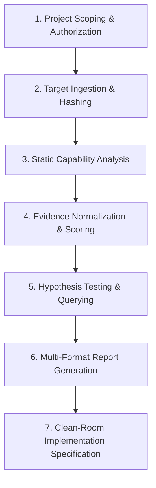

# Investigation & Evidence Workflow Guide

This guide details the complete end-to-end investigation workflow in SRE Studio, from initial scoping and authorization to evidence collection, hypothesis formulation, and clean-room independent implementation.

---

## The Clean-Room Reverse Engineering Workflow

SRE Studio enforces a structured, evidence-based methodology designed for legal compliance, auditability, and technical rigor:



---

## Step 1: Scoping & Authorization Setup

Before analyzing any software artifact, an explicit authorization boundary must be established. SRE Studio employs a **fail-closed** authorization policy: if no authorization rules are configured, all operations are denied.

### CLI Initialization
```bash
sre-studio init ./my-investigation \
  --name "Network Protocol Analysis" \
  --scope "Static reverse engineering of proprietary client telemetry protocol" \
  --auth-type owner
cd ./my-investigation
```

### Authorization Configuration (`sre-project.json`)
The initialization command generates an `sre-project.json` file in the project directory:

```json
{
  "id": "proj-a1b2c3d4",
  "name": "Network Protocol Analysis",
  "scope": "Static reverse engineering of proprietary client telemetry protocol",
  "authorization": {
    "type": "owner",
    "grantedBy": "Security Engineering",
    "grantedAt": "2026-11-08T10:00:00.000Z",
    "allowedPathPatterns": [
      "./targets/**",
      "../tests/fixtures/**"
    ],
    "allowedCapabilities": [
      "binary.*",
      "android.*"
    ]
  }
}
```

> [!IMPORTANT]
> The target path patterns strictly contain analysis operations. Paths containing `..` or symlinks that resolve outside authorized directories are rejected automatically by the boundary validator.

---

## Step 2: Target Ingestion & Verification

Register the target artifact with the investigation session. SRE Studio computes SHA-256 hashes, detects file formats, and logs the target immutably in SQLite.

```bash
sre-studio target add ./targets/telemetry-client.exe \
  --type binary \
  --role primary
```

### Inspecting Target State
```bash
sre-studio status
sre-studio target list
```

---

## Step 3: Running Static Capability Analyses

Capabilities can be executed selectively or in batch passes. SRE Studio supports both external tool analysis (when tools like Rizin, JADX, or aapt2 are installed) and self-contained static parsing.

### Inspect Available Capabilities
```bash
sre-studio capabilities
```

### Running Binary Capabilities
```bash
# Extract file format, architecture, and headers
sre-studio analyze binary.info

# Extract sections and permissions (RX, RW, etc.)
sre-studio analyze binary.sections

# Extract dynamic imports (imported DLLs and Win32/POSIX APIs)
sre-studio analyze binary.imports

# Extract ASCII and UTF-16 strings
sre-studio analyze binary.strings --param minLength=6
```

### Running Android Capabilities
```bash
# Parse AndroidManifest.xml for components, permissions, and SDK versions
sre-studio analyze android.manifest

# Verify APK signing schemes (v1, v2, v3) and cert fingerprints
sre-studio analyze android.signatures

# Inspect declared and dangerous permissions
sre-studio analyze android.permissions
```

---

## Step 4: Evidence Inspection & Confidence Scoring

All analysis outputs are processed by the **Evidence Engine**. Findings are normalized and scored using a multi-factor confidence model:

- **Verification Factors**:
  - `heuristicWeight`: Reliability of the detection rule (0.0 to 1.0)
  - `toolReliability`: Historical precision of the provider tool
  - `crossValidation`: Boost awarded when multiple tools or methods confirm the finding
  - `manualVerification`: Operator confirmation score

### Querying Evidence via CLI
```bash
# List all high-severity findings
sre-studio evidence list --severity high

# Filter by minimum confidence score
sre-studio evidence list --confidence 0.85

# View detailed evidence payload and provenance for a finding
sre-studio evidence get find-9f8e7d6c

# Display an executive breakdown
sre-studio evidence summary
```

### Evidence Provenance & Environment Snapshots
Every finding stores an immutable reference to the `environments` table in SQLite, recording:
- Operating system version and architecture
- Node.js runtime version
- Provider ID and version
- External tool binary versions (`aapt2 --version`, `rizin -v`, etc.)
- Target file SHA-256 hash at time of analysis

---

## Step 5: Multi-Format Report Generation

Once evidence has been gathered, generate structured reports tailored for technical analysts, executives, or security auditors:

### Markdown Report (Technical Audit)
```bash
sre-studio report --format markdown --output docs/investigation-report.md
```

### Interactive HTML Report (Stakeholder Review)
```bash
sre-studio report --format html --output docs/investigation-report.html
```

### JSON Data Export (CI/CD & Automation)
```bash
sre-studio report --format json --output dist/findings.json
```

### SARIF v2.1.0 Report (Static Analysis Security Scanners)
```bash
sre-studio report --format sarif --output dist/findings.sarif
```
The SARIF report conforms to OASIS SARIF v2.1.0 and integrates directly with GitHub Advanced Security code scanning and IDE problem panes.

---

## Step 6: Clean-Room Implementation Methodology

SRE Studio is built specifically to support lawful clean-room software design. When your objective is to build an independent, interoperable reimplementation of a proprietary protocol or format:

1. **Dirty Room (Reverse Engineering)**:
   - The analyst operates inside SRE Studio to inspect targets, document observable behaviors, extract data structures, and map API contracts.
   - All extracted behavior is compiled into an **Interoperability Specification** (Markdown or HTML report).
   - The analyst does **NOT** write implementation source code.

2. **Clean-Room Specification**:
   - The specification must describe functional behavior, packet layouts, encryption handshake sequences, and error codes **in abstract prose and schema definitions**.
   - No decompiled source code, copyrighted constants, or proprietary implementation logic may appear in the specification.

3. **Clean Room (Independent Implementation)**:
   - A separate development team with **no access** to the original target artifacts or reverse engineering environment reads only the Interoperability Specification.
   - The clean-room team writes a clean implementation from scratch.
   - SRE Studio's SQLite audit trail provides legal provenance proving that the clean-room developers had no direct access to the proprietary binary.

---

## Session Closure & Archival

Upon concluding an investigation:
```bash
sre-studio close --reason completed --summary
```
This finalizes session state, records the completion timestamp, and prevents further unauthorized modifications to the project's SQLite repository.

